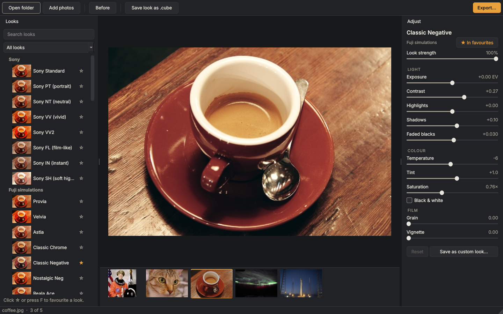

<p align="center">
  <picture>
    <source media="(prefers-color-scheme: dark)" srcset="docs/logo-dark.png">
    
  </picture>
</p>

<p align="center">
  <a href="https://ajr-alves.github.io/"><b>Website</b></a> ·
  <a href="https://github.com/ajr-alves/emulsa/releases/latest"><b>Download</b></a> ·
  <a href="#install">Install</a> ·
  <a href="#updating">Updating</a> ·
  <a href="#the-look-assistant">Look assistant</a>
</p>

Film looks for your photos. Pick a look, see it on your photo instantly, tweak it, and export one photo or a whole folder.



Emulsa ships with 100 looks. 77 of them are film stocks and camera styles: Fuji film simulations, Kodak, Ilford and Cinestill stocks, Ricoh GR, Leica, Canon, Nikon and more. They started life as in-camera recipes for Sony cameras (from [Recipe Lab](https://github.com/voxivoid/recipe-lab-sony-pmca/tree/v1.7.0)). Emulsa turns each recipe into a colour grade a computer can apply to any photo, from any camera, and adds what a camera setting can't express: split toning, per-colour shifts, faded blacks and grain.

The other 23 are Emulsa's own. **Movies** are grades inspired by films, from Dune and Blade Runner 2049 to The Shining, The Lighthouse and The Batman. **Moods** aren't tied to any film: Teal & Orange, Golden Hour, Matte Moody, Neon Night and more.

## What it does

- **Opens one photo, a few, or a whole folder**: drop them in or pick them. Works with JPEG, PNG, TIFF and RAW files (Sony .ARW, Canon .CR2/.CR3, Nikon .NEF, Fuji .RAF, .DNG and others).
- **Shows only RAW files or only JPEGs** when you shoot RAW+JPEG, with a switch above the photos, so each shot doesn't appear twice.
- **Zooms in to full resolution.** Scroll or pinch to zoom, drag to move around, double-click for 100%. The look is applied at full detail, RAW included.
- **Shows every look on your own photo** in the looks list, so you can see the result before you click.
- **Adjusts any look** with exposure, contrast, highlights, shadows, faded blacks, temperature, tint, saturation, grain, vignette and black & white. Hold the `\` key to compare with the original.
- **Saves your own versions** as custom looks, and lets you star favourites.
- **Exports in the background** to JPEG, TIFF or PNG, at full size or resized, so you can keep working. Queue up as many exports as you like, for example the same photos in two looks; they run one after another, and the Exports button in the top bar shows their progress. Your originals are never changed. EXIF data from JPEGs is kept.
- **Saves any look as a .cube LUT** for DaVinci Resolve, Premiere, Final Cut or OBS (grain and vignette aren't part of a LUT).
- **Look assistant.** Click the button in the corner of the photo, describe a look ("warm 70s film, faded blacks") or attach a photo whose colours you like, and it builds the look on your photo. Undo it or save it as your own.
- **Light and dark mode**, following your system.

## Install

Download the file for your computer from the [Releases](https://github.com/ajr-alves/emulsa/releases/latest) page.

| System | File | First launch |
| --- | --- | --- |
| Windows 10/11 (64-bit) | `EmulsaSetup-x.y.z.exe` | If Windows says it protected your PC, click **More info → Run anyway**. |
| macOS 11+ on Apple Silicon (M1 and newer) | `Emulsa-x.y.z-macOS-arm64.dmg` | Drag Emulsa to Applications. The first time, macOS blocks it: open **System Settings → Privacy & Security** and click **Open Anyway**. |
| Linux (x86-64) | `Emulsa-x.y.z-x86_64.AppImage` | `chmod +x Emulsa-*.AppImage` then run it. If it won't start, install `libxcb-cursor0` (Ubuntu/Debian) or `xcb-util-cursor` (Fedora/Arch). |

The warnings appear because the app isn't signed with a paid developer certificate yet. Intel Macs can run Emulsa from source (below).

## Updating

**Emulsa tells you when there's a new version.** Once a day it checks this project's Releases page, and if there's something newer, a small notice appears at the bottom of the looks list with **Download** and **What's new**. Click × to skip that version. You can also check any time from the ••• menu → **Check for Updates…**, or turn automatic checks off there.

The check only reads the public release information from GitHub. Nothing about you or your photos is sent, and Emulsa never downloads or installs anything by itself.

To update by hand:

Your favourites, custom looks, settings and assistant key are kept when you update. They're stored in your user folder, not inside the app, so replacing the app never touches them.

1. **Get the new version** from the [Releases](https://github.com/ajr-alves/emulsa/releases/latest) page. Between releases, the newest build is under [Actions](https://github.com/ajr-alves/emulsa/actions): open the latest run marked ✓ and download the file for your system under **Artifacts** (you need to be signed in to GitHub).
2. **Install it over the old one:**
   - **Windows:** close Emulsa and run the new `EmulsaSetup-x.y.z.exe`. It replaces the old version in place, so there's no need to uninstall first.
   - **macOS:** open the new `.dmg`, drag Emulsa to Applications and choose **Replace**.
   - **Linux:** replace the old `.AppImage` file with the new one and make it executable again (`chmod +x`).
3. **Check the version** in the ••• menu → **About Emulsa**.

**If you build Emulsa yourself:**

- **Cloned with git:** run `git pull`, then build again (`build.bat` on Windows) and run the new installer from the `dist` folder.
- **Downloaded a zip:** download the new zip from the green **Code** button and copy its files over your folder. You can keep `.venv`, `build` and `dist`. Then build again the same way. `build.bat` installs any new requirements on its own.

## The look assistant

The assistant runs on Claude, using **your own Anthropic API key**, so it costs you nothing beyond your own API usage, typically a few cents per message.

1. Get a key from the [Claude Console](https://platform.claude.com/).
2. Click the button in the corner of the photo and paste the key.
3. Describe a look or attach reference photos (up to 4 per message).

**Privacy:** when you press Send, a copy of your current photo (shrunk to 1024 px) and any reference photos you attached go to Anthropic to answer that message. Nothing is sent otherwise. Your key is stored in your system's keychain (Windows Credential Manager, macOS Keychain or the Linux Secret Service), never in Emulsa's settings file. If no keychain is available, the key is only kept until you close Emulsa. You can also set the `ANTHROPIC_API_KEY` environment variable instead.

Emulsa treats the assistant's answers as data: every setting is checked against a fixed list and clamped to a safe range, and replies are shown as plain text.

## Keyboard

On a Mac, use `Cmd` instead of `Ctrl`.

| Key | Does |
| --- | --- |
| `\` (hold) | Show the original photo |
| `F` | Add or remove the current look from favourites |
| `Ctrl+O` | Open a folder |
| `Ctrl+Shift+O` | Open individual photos |
| `Ctrl+0` | Fit the photo to the window |
| `Ctrl+1` | Zoom to 100% |
| `Ctrl+=` / `Ctrl+-` | Zoom in / out |
| Scroll or pinch | Zoom at the cursor (drag to move around) |
| Double-click the photo | Switch between Fit and 100% |
| `Ctrl+E` | Export |
| `Ctrl+K` | Open the look assistant |
| `Ctrl+Shift+E` | Save the look as a .cube |
| Double-click a slider | Return it to the look's value |

## Run from source

```
python -m venv .venv
.venv\Scripts\activate            # macOS/Linux: source .venv/bin/activate
pip install -r requirements.txt
python run_emulsa.py
```

Works on Windows, macOS (Apple Silicon and Intel) and Linux with Python 3.11 or newer.

## Build the apps

- **Windows:** install [Python](https://www.python.org/downloads/) and [Inno Setup 6](https://jrsoftware.org/isinfo.php) (either "for all users" or "for me only" works), then double-click `build.bat`. It ends with `dist\EmulsaSetup-x.y.z.exe`; if anything fails, the details are in `build.log`.
- **macOS:** `pip install -r requirements.txt pyinstaller && pyinstaller packaging/emulsa.spec && bash packaging/make_dmg.sh`
- **Linux:** `pip install -r requirements.txt pyinstaller && pyinstaller packaging/emulsa.spec && bash packaging/make_appimage.sh`

Every build can check itself with `Emulsa --self-test`.

On GitHub, `.github/workflows/build.yml` runs on every push. It first runs the safety checks: the unit tests, a security scan of the code ([bandit](https://bandit.readthedocs.io/)) and a check of every dependency against known vulnerabilities ([pip-audit](https://pypi.org/project/pip-audit/)). Then it builds and self-tests the Windows, macOS and Linux apps. When the version number in `emulsa/__init__.py` changes, the next push to `main` publishes a release with all three installers attached.

## How the looks work

Each look is a small set of numbers (see `emulsa/engine.py`, `DEFAULTS`). The engine runs those numbers through one pipeline on a 33×33×33 grid of colours, which gives a 3D LUT. Photos are graded by looking colours up in that LUT, so the preview, the export and a saved .cube file always match.

To add or tune a look, edit `emulsa/looks.py`:

- `RECIPES` holds the in-camera settings: Creative Style, saturation, contrast, white balance, DRO, exposure and Picture Effect.
- `CHARACTER` holds the film character layered on top: split toning, per-colour hue and saturation, faded blacks, grain.
- `EXTRA` holds Emulsa's own looks (Movies and Moods), written directly as engine parameters.

Run the tests with `python -m unittest discover -s tests`.

## Thanks

Emulsa wouldn't exist without **[André Domingues (voxivoid)](https://github.com/voxivoid)** and his app [Recipe Lab](https://github.com/voxivoid/recipe-lab-sony-pmca). He worked out how to store film looks inside the Sony A6000 and built the 77 recipes this app starts from, testing them against reference frames on the camera itself. Thank you, André. If you shoot an older Sony that runs camera apps, use Recipe Lab on the camera, and consider [sponsoring his work](https://github.com/sponsors/voxivoid).

## Credits and licence

MIT licence; see [LICENSE](LICENSE). The recipe values come from Recipe Lab v1.7.0 by André Domingues, released under MIT. The wordmark is set in Bricolage Grotesque (SIL Open Font License). Details in [THIRD_PARTY_NOTICES.md](THIRD_PARTY_NOTICES.md).

Film and camera names describe the look each preset approximates, and film titles name the movie whose colour a look is inspired by. Emulsa isn't affiliated with or endorsed by Fujifilm, Kodak, Ilford, Cinestill, Ricoh, Leica, Hasselblad, Canon, Nikon, Panasonic, Olympus, Agfa, Polaroid or Sony, or by the makers of any film named here.
